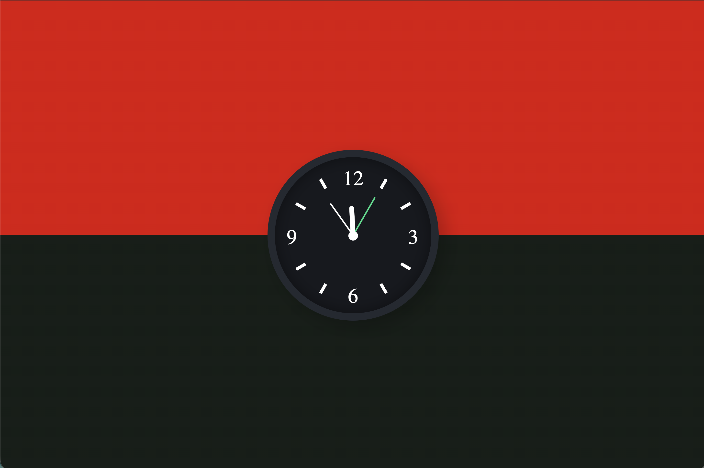

# Analoge klok

Een analoge klok in de browser die de echte tijd laat zien, met een uur-, minuten- en secondewijzer.

Gemaakt in mijn eerste jaar Software Developer aan het Grafisch Lyceum Rotterdam.

## Hoe het werkt

Elke seconde leest JavaScript de huidige tijd uit met `new Date()` en rekent uit hoeveel graden elke wijzer moet draaien:

- Uurwijzer: 30 graden per uur, plus een halve graad per minuut
- Minutenwijzer: 6 graden per minuut, plus een beetje per seconde
- Secondewijzer: 6 graden per seconde

De wijzers draaien met CSS `transform: rotate()`. De wijzerplaat is een SVG-afbeelding.

## Gebruikte technieken

- HTML
- CSS (positioneren, `transform`, `transform-origin`)
- JavaScript (`setInterval`, `Date`)
- SVG

## Wat ik heb geleerd

- Tijd uitlezen en omrekenen naar graden
- Elementen laten draaien rond een vast punt met `transform-origin`
- Een functie elke seconde laten uitvoeren met `setInterval`

## Zelf uitproberen

Download de bestanden en open `index.html` in je browser.# clockwork-ui
